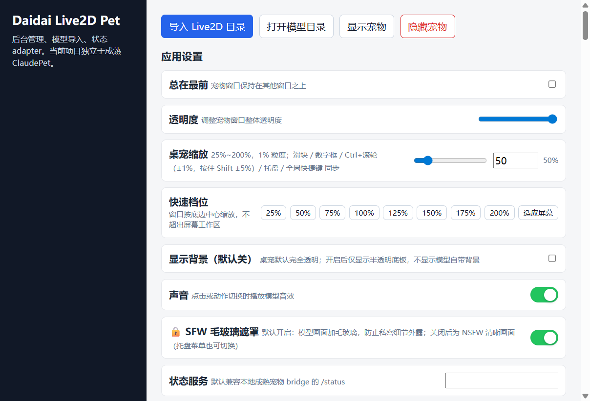
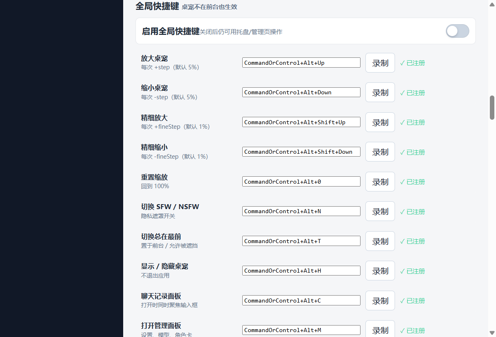
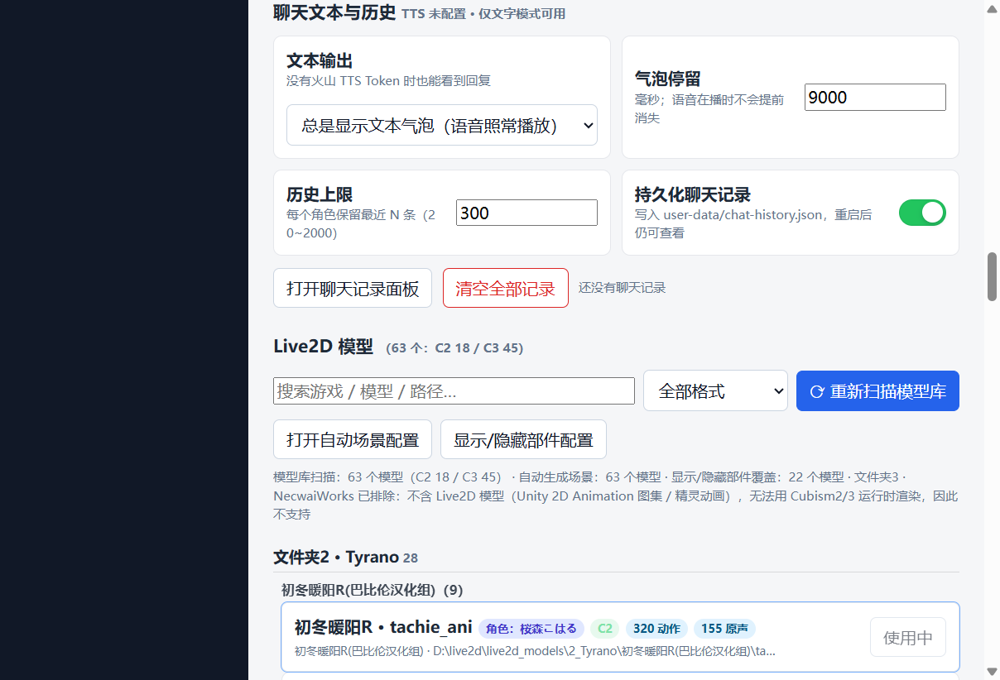
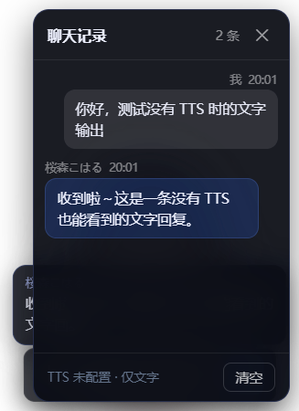
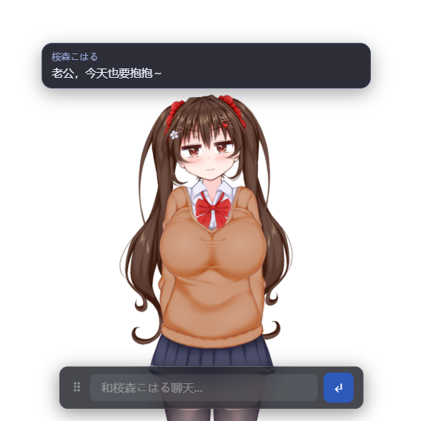
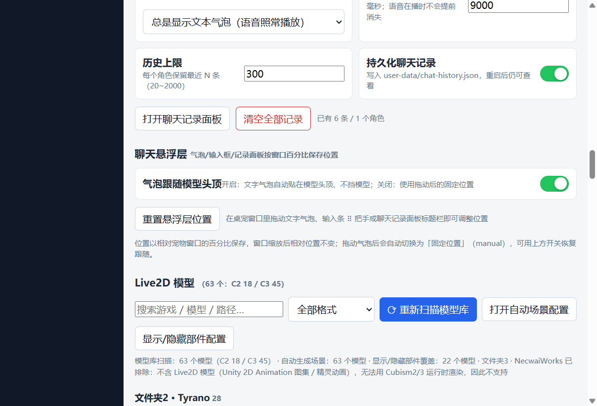
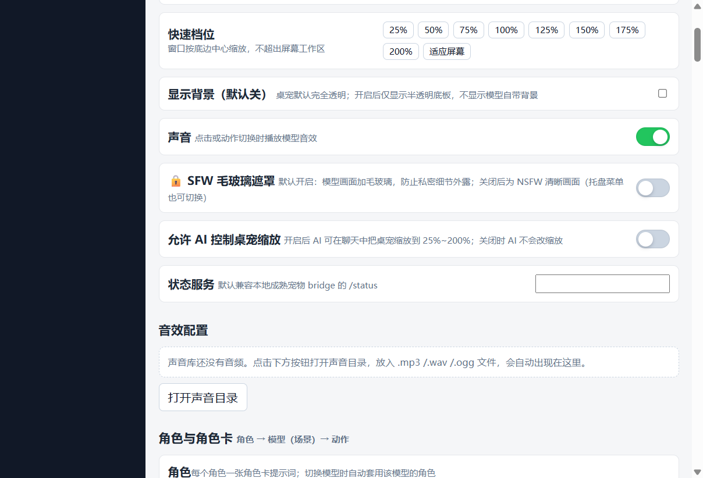
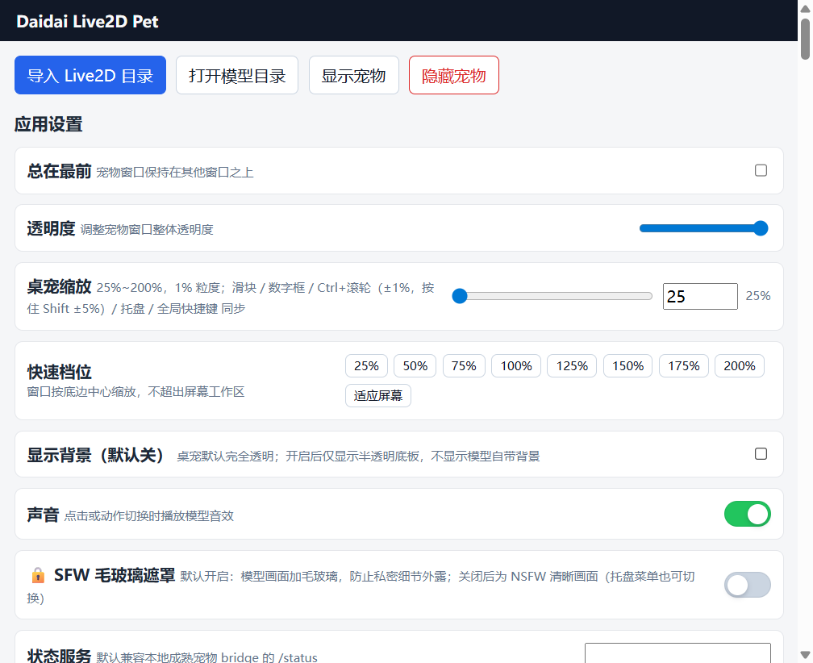

# Daidai Live2D Pet 🐱

[](LICENSE)
[](https://nodejs.org/)
[](https://www.electronjs.org/)

开箱即用的 Live2D 桌面宠物：Electron 透明宠物窗 + 系统托盘 + 后台管理 + 多模型导入 + AI 会话状态提醒 + 角色聊天 + TTS 语音 + 口型同步 + 动作/场景系统 + 可拖动聊天悬浮层。

> 本项目基于 [Rosa134/daidai-live2d-pet](https://github.com/Rosa134/daidai-live2d-pet)（MIT）继续开发，新增了 **全局快捷键 / 25%~200% 精细缩放 / 聊天文本输出与历史记录 / 角色卡与场景目录 / 可拖动聊天悬浮层 / AI 控制缩放** 等能力。
> 仓库**不包含任何 Live2D 模型文件**：模型只从本地模型库或管理页导入，请自行确认模型授权。

## 截图

| 管理页：缩放与快捷档位 | 管理页：全局快捷键 |
|---|---|
|  |  |

| 管理页：聊天文本与历史 | 桌宠：聊天记录面板（TTS 未配置也可用） |
|---|---|
|  |  |

| 桌宠：文字气泡贴模型头顶（不遮挡） | 管理页：聊天悬浮层（拖动位置百分比保存） |
|---|---|
|  |  |

| 管理页：允许 AI 控制缩放（默认关） | 管理页：窄窗口 / 高 DPI 响应式布局 |
|---|---|
|  |  |

## ✨ 特性

- **角色聊天** — 底部输入框直接和角色聊天，OpenAI 兼容接口（默认 DeepSeek），和 Codex/Claude 状态提醒互不干扰
- **可拖动聊天悬浮层** — 文字气泡默认贴在模型头顶（跟随模型、不挡画面）；气泡、输入框、聊天记录面板都能自由拖动，位置按宠物窗口百分比保存；管理页可一键重置、可关闭「跟随模型头顶」
- **聊天文本 + 历史记录** — TTS 只是增强：没有配置 TTS Token 时也会显示文字气泡，并可随时打开聊天记录面板、按角色持久化保存
- **角色卡 → 模型 → 场景 → 动作** — 每个角色一张提示词，一个角色可包含多个模型；每个模型下再分场景/动作，聊天时按当前模型自动取角色卡
- **聊天里切换模型** — 直接说「换成 k04_kijoui_ani」「切到骑乘位那个场景」「换回上一个」即可让 AI 调用 `switch_model`：支持按显示名/目录名/场景语义模糊匹配（「后背位」「手交」「接吻」等），会记住上一个模型；只说游戏名时返回候选不会乱切
- **聊天记录面板直接对话** — 输入框旁「记录」按钮一键打开面板；面板底部有独立输入框，看着历史也能直接聊天
- **SFW 毛玻璃遮罩** — 默认开启且强模糊（默认 42px，最低按 30px 渲染 + 强降饱和/灰度），开启后人物细节完全不可辨认；托盘/快捷键/管理页可切换 NSFW 清晰画面
- **音效单通道** — 动作/点击/场景原声同一时刻只播一个，切模型或播新语音会自动停掉旧声音，连续点击不会叠音
- **精细缩放** — 25%~200% 任意百分比（1% 步进），9 档快捷档位，`Ctrl+滚轮` 微调，全局快捷键 ±5% / ±1%
- **AI 控制缩放（可选）** — 管理页开启「允许 AI 控制桌宠缩放」后，AI 可在聊天中按你的要求调用 `set_scale` 把桌宠调到 25%~200%；默认关闭，关闭时 AI 不会改缩放
- **全局快捷键** — 10 个动作可自定义/录制：缩放、重置 100%、SFW/NSFW、总在最前、显示/隐藏、聊天面板、管理面板；冲突检测 + 注册失败自动回滚旧键
- **系统托盘** — 显示/隐藏宠物、SFW 开关、置顶开关、打开管理、退出
- **AI 状态联动** — 监听 Codex / Claude Code 会话，自动切换 Live2D 动作（思考/工作/回复/待机）
- **TTS 语音 + 口型同步** — 火山引擎 TTS；Web Audio RMS 驱动 `ParamMouthOpenY`，语音播放时嘴型跟随
- **随机肢体动作 / 动作音效** — 从当前模型已有 motion 中抽样播放，避免不同模型动作名不一致；每个状态动作可独立选择音效
- **模型管理** — 管理页扫描本地模型库或导入单个模型目录，支持 Cubism2（`.model.json`）与 Cubism3+（`.model3.json`）
- **SFW 毛玻璃遮罩** — 默认开启；托盘/快捷键/管理页可切换 NSFW 清晰画面
- **系统托盘 + 内置状态桥** — 端口 23334，兼容 [ClaudePet](https://github.com/liuchenlili/ClaudePet) 协议

## 快速开始

需要 Node.js 18+。Windows 10/11 下已测试；国内用户建议先设置 Electron 镜像：

```powershell
# 1. 克隆仓库
git clone https://github.com/CookieWYQ/daidai-live2d-pet.git
cd daidai-live2d-pet

# 2. 设置 Electron 镜像（国内网络建议，否则二进制下载可能失败）
$env:ELECTRON_MIRROR="https://npmmirror.com/mirrors/electron/"

# 3. 安装依赖
npm install

# 4. 启动
npm start
```

启动后：

- 系统托盘出现猫耳图标
- 右键托盘 → 「设置」打开管理窗口；管理窗口里选择/导入模型
- 宠物自动监听 `http://127.0.0.1:23334/status` 获取 AI 状态
- 角色聊天：管理页配置文字 API Key（TTS Token 可选），底部输入框直接聊天

模型文件不随仓库分发。两种用法：

1. **导入单个模型**：管理页 →「导入 Live2D 目录」→ 选择含 `.model.json` / `.model3.json` 的目录；
2. **扫描本地模型库**（可选）：设置环境变量或配置 `user-data/config.json` 的 `modelLibraryRoots`：

```powershell
$env:DAIDAI_MODEL_LIBRARY="D:\Live2DModels"   # 目录下按 1_FFhouse / 2_Tyrano 组织，可选
npm start
```

> 模型库目录约定：`<根目录>/1_FFhouse/<游戏>/<模型目录>`、`<根目录>/2_Tyrano/<游戏>/<模型目录>`。
> 未配置模型库时扫描结果为空，不影响手动导入模型。

## 桌宠缩放

管理页「应用设置 → 桌宠缩放」：

- **范围 25%~200%**，滑块 / 数字框 / 快捷档位 / 全局快捷键 / 托盘共用同一套比例
- **1% 粒度**：滑块和数字框可精确到 1%；`Ctrl+滚轮` 在宠物窗上 ±1%（按住 `Shift` ±5%）
- **9 个快捷档位**：25% / 50% / 75% / 100% / 125% / 150% / 175% / 200% / 适应屏幕
- 窗口按底边中心缩放，不会跑出屏幕工作区；窗口尺寸上限受屏幕限制时，管理页会提示「实际显示 N%」
- **AI 控制缩放（默认关闭）**：管理页「应用设置 → 允许 AI 控制桌宠缩放」。开启后 AI 能力清单多一个 `set_scale` 工具（25%~200%，整数百分比），聊天里说「变大一点 / 缩到 80%」就会生效，并弹出「桌宠缩放 N%」提示；关闭后工具从 schema 中消失，执行器也会拒绝调用

## 全局快捷键

管理页「全局快捷键」区域可逐个录制/修改，也可直接手输 Electron accelerator 语法；留空 = 禁用该动作。

| 动作 | 默认快捷键 | 说明 |
|---|---|---|
| 放大桌宠 | `Ctrl+Alt+↑` | 每次 +5%（步进可改，1~25） |
| 缩小桌宠 | `Ctrl+Alt+↓` | 每次 -5% |
| 精细放大 | `Ctrl+Alt+Shift+↑` | 每次 +1%（精细步进可改，1~10） |
| 精细缩小 | `Ctrl+Alt+Shift+↓` | 每次 -1% |
| 重置缩放 | `Ctrl+Alt+0` | 回到 100% |
| 切换 SFW / NSFW | `Ctrl+Alt+N` | 隐私毛玻璃遮罩开关 |
| 切换总在最前 | `Ctrl+Alt+T` | 置于前台 / 允许被遮挡 |
| 显示 / 隐藏桌宠 | `Ctrl+Alt+H` | 不退出应用 |
| 聊天记录面板 | `Ctrl+Alt+C` | 打开/关闭聊天记录并聚焦输入框 |
| 打开管理面板 | `Ctrl+Alt+M` | 设置、模型、角色卡 |

实现细节：

- 使用 Electron `globalShortcut`，桌宠不在前台时也生效；应用退出时自动注销
- 点「录制」后 10 秒内按下组合键（必须含 Ctrl/Alt/Shift），`Esc` 取消；保存前会先试注册
- 组合键被其它程序占用或与其它动作重复时，会在管理页标红；**新键注册失败会回滚旧键**，不会出现"改一次键所有快捷键都失效"

## 聊天文本与历史记录

TTS 是可选增强，文字输出始终可用：

- **三种文本模式**：总是显示文字气泡（语音照常播放）/ 仅 TTS 未配置或失败时显示 / 只用语音不显示
- **文字气泡**：默认贴在模型头顶（按模型实际绘制内容的包围盒定位，不遮挡人物），可点击直接打开聊天记录面板；停留时长可配置（1.5~60 秒，语音播放时不会提前消失）
- **可拖动布局**：按住文字气泡即可拖动；输入条左侧 `⠿` 把手可拖动输入框；聊天记录面板可拖标题栏移动。位置按宠物窗口的百分比保存（窗口缩放后相对位置不变），管理页「聊天悬浮层」可恢复「跟随模型头顶」或一键重置全部位置
- **记录按钮**：输入框旁「记录」按钮直接打开聊天记录面板；面板底部自带输入框，可以边看历史边直接聊天（与主输入框共用同一套发送/记忆/持久化逻辑）
- **聊天记录面板**：默认在宠物窗右侧，按角色分组，显示「我 / 角色名 + 时间」，可滚动查看、一键清空；快捷键 `Ctrl+Alt+C`
- **持久化**：写入 `user-data/chat-history.json`，重启后仍在；每个角色保留最近 N 条（20~2000，默认 300），可关闭持久化
- TTS Token 配置后，语音照常播放并驱动口型/说话动作，文字气泡可同时显示

## 聊天里切换模型

聊天接口支持 function calling 时，AI 可以直接切换桌宠模型（需要「AI 自动切换场景/动作」保持开启）：

- 说法示例：「换成 k04_kijoui_ani」「切到 k03_tekoki_ani 那个模型」「想看她后背位/手交/接吻」「换回上一个」「切回刚才那个」
- 可用 `model_id`（精确）、`model_name`（显示名/目录名/游戏名/场景语义，模糊匹配）、`previous=true`（上一个模型）；名称不确定时 AI 会先调用 `list_models` 搜索，不需要用户报文件名
- 场景语义来自场景目录的标签/描述/关键词：用户说「后背位」「口交」「剖面」「日常立绘」时，AI 直接按意思匹配模型，而不是要求用户输入名字
- 上一个模型由主进程记录：管理页点选、AI 切换、场景目录切换都会更新，因此「换回去」始终指最近一次切换前的模型
- 只说游戏名（例如「初冬暖阳R」）会返回该游戏下的候选模型与提示，不会随便挑一个；切换成功会等模型真正加载完再回复
- SFW 开启时，NSFW 限定模型/辅助剖面模型仍会被拒绝并提示先开启 NSFW

## 界面渲染与高 DPI

- 管理窗**禁止页面缩放**（Ctrl+滚轮 / 触控板缩放会被拦截），加载/显示/显示器 DPI 变化时会自动把页面缩放复位到 100%，避免 Chromium 只绘制半幅内容导致的「左侧被裁、右侧空白」
- 管理窗布局是响应式的：窗口变窄时侧栏收为顶部条、设置行自动堆叠、快捷档位按钮换行；125% 页面缩放或 780px 窄窗口下也不会出现中文竖排/横向溢出
- 桌宠窗本身按屏幕工作区 clamp，缩放、置顶、透明背景、点击/拖动互动互不影响

## 配置密钥

密钥不会写入源码。应用会优先读取本机运行时配置，其次读取环境变量：

| 用途 | 管理页字段 | 环境变量回退 | 是否必需 |
|---|---|---|---|
| 文本模型 API Key | 文字 API Key | `DEEPSEEK_API_KEY` 或 `OPENAI_API_KEY` | 聊天需要 |
| 火山 TTS Token | 火山 Token | `VOLCENGINE_TOKEN` | 可选（不填=纯文字） |

本机配置文件位于 `user-data/config.json`（便携模式下与 exe 同级）。仓库 `.gitignore` 已忽略 `user-data/`、日志和临时文件；公开提交前仍建议运行密钥扫描。

## 接入 AI 会话

宠物内置状态桥（端口 23334），兼容 ClaudePet 协议：

```bash
# 查看当前状态
curl http://127.0.0.1:23334/status

# 推送事件
curl -X POST http://127.0.0.1:23334/event -H "Content-Type: application/json" -d '{"kind":"thinking","text":"思考中..."}'
```

Codex 用户：宠物自动监听 `.codex/sessions/*.jsonl`，无需手动配置。
Claude Code 用户：参考 [ClaudePet](https://github.com/liuchenlili/ClaudePet) 的 hook 配置。

## 导入模型与模型库

1. 打开管理窗口（托盘 → 设置）
2. 点击「导入 Live2D 目录」
3. 选择包含 `.model.json`（Cubism2）或 `.model3.json`（Cubism3+）的目录
4. 模型会复制到 `user-data/models/`（便携模式下与 exe 同级）

本地模型库扫描（可选）：设置 `DAIDAI_MODEL_LIBRARY` 环境变量，或在 `user-data/config.json` 写：

```json
{
  "modelLibraryRoots": ["D:/path/to/live2d_models"]
}
```

目录下按 `1_FFhouse/<游戏>/<模型目录>`、`2_Tyrano/<游戏>/<模型目录>` 组织即可。扫描只读引用模型路径，不复制资源；`3_NecwaiWorks`（Unity 2D Animation 图集）会被识别为不支持并给出提示。

> 仓库不附带模型。示例截图里的角色来自开发者本机模型库；公开分发前请确认模型授权（Live2D Cubism SDK 与各模型版权归原作者）。

## 开发

```bash
npm install
npm test          # 单元测试（config-store / chat-history / scene / ai-control / status 等）
npm run doctor    # 检查关键文件
npm start         # 启动应用
npm run dev       # 开发模式（带 DevTools）
npm run pack      # 打包到 dist/win-unpacked/（仅解包目录）
npm run dist      # 构建 Windows 便携版 exe
```

UI 自检（需要调试端口，会自行启动 mock LLM，不消耗真实 API）：

```powershell
$env:DAIDAI_DEBUG_HOOKS="1"; $env:DAIDAI_DEBUG_PORT="9333"; npm start
node scripts/ui-check.mjs --port=9333 --out=../screenshots/v2
```

脚本会验证：10 个快捷键注册与动作、25% 档位 / 100% 重置、SFW/置顶切换、TTS 未配置时的文字气泡、聊天记录落盘、管理页控件，并保存截图。

悬浮层 + AI 缩放端到端自检（CDP + 本地 mock LLM，不消耗真实 API）：

```powershell
node scripts/verify-overlay-ai.mjs --port=9333
```

验证内容：文字气泡 follow 头顶锚点、拖动气泡/输入条/记录面板后百分比落盘、拖动不带动宠物窗；`set_scale` 能力 schema、执行器开关校验、mock LLM tool_calls 全链路、关闭开关后拒绝调用；结果写入 `screenshots/overlay/overlay_ai_verify.json`。

聊天切换模型 + 聊天面板端到端自检（CDP + 本地 mock LLM，不消耗真实 API；强制 SFW、关闭声音）：

```powershell
node scripts/verify-model-switch.mjs --port=9333
```

验证内容：按模型名切换并等加载完成、「换回去」按 `previous` 切回、上一个模型记录与能力清单刷新、`list_models` 语义搜索、游戏名歧义候选、SFW 下 NSFW 模型拦截、「记录」按钮与面板内直接聊天；结果写入 `screenshots/model-switch-sfw/model_switch_verify.json`。

> 测试纪律：所有自动化脚本都要求启动时加 `--sfw`，并在测试中强制 SFW 强模糊（≥30px）、关闭声音；截图不可辨认。

### 项目结构

```
├── config/                 # 内置配置（角色卡种子、场景目录、手工场景）
├── src/
│   ├── main/               # Electron 主进程
│   │   ├── main.js              # 窗口、托盘、全局快捷键、IPC、缩放、聊天/TTS
│   │   ├── config-store.js      # 配置读写与校验（缩放/快捷键/聊天字段）
│   │   ├── chat-history.js      # 聊天历史落盘（按角色、条数裁剪）
│   │   ├── model-registry.js    # 模型注册表（导入/扫描/校验）
│   │   ├── model-library.js     # 本地模型库扫描（根目录可配置，不写死路径）
│   │   ├── scene-catalog.js     # 场景目录（角色→模型→场景→动作）
│   │   ├── scene-config.js      # 场景配置合并与提示词
│   │   ├── character-registry.js# 角色卡注册表
│   │   ├── status-bridge.js     # 内置 23334 状态桥
│   │   ├── status-poller.js     # 状态轮询 + 归一化
│   │   └── codex-session-monitor.js # Codex JSONL 监听
│   ├── renderer/           # 渲染进程
│   │   ├── app.js              # Live2D、悬浮层、气泡、状态、聊天、TTS、口型、交互
│   │   ├── index.html          # 入口（管理窗 + 宠物窗）
│   │   ├── styles.css          # 样式（含聊天气泡/面板、快捷键设置）
│   │   ├── manager-responsive.css # 管理页响应式 / 窄窗口 / 高 DPI 兜底
│   │   ├── manager-guard.js    # 管理页禁止页面缩放 + 异常缩放复位
│   │   ├── scenes.html/js      # 动作与场景面板
│   │   └── vendor/             # PIXI + Cubism runtime
│   └── preload.js          # contextBridge IPC
├── scripts/                # ui-check / doctor 等工具
├── tests/                  # 单元测试（node:test）
├── docs/                   # 架构、模型导入、截图
└── bin/                    # CLI 入口
```

## 参考与致谢

- **[Rosa134/daidai-live2d-pet](https://github.com/Rosa134/daidai-live2d-pet)**（MIT）— 本项目的起点：Electron 透明宠物窗、托盘、模型管理、状态提醒与 TTS/口型实现
- **[ClaudePet](https://github.com/liuchenlili/ClaudePet)** — 状态协议与透明窗设计理念（23334 端口协议）
- **[song-423/dsh-pet](https://github.com/song-423/dsh-pet)** — 可配置快捷键、聊天记录/记忆面板的产品思路参考
- **[Soundpulse/hermes-live2d](https://github.com/Soundpulse/hermes-live2d)** — Tauri + pixi-live2d-display 桌宠的窗口状态与交互参考
- **[x380kkm/Live2DPet](https://github.com/x380kkm/Live2DPet)** — AI 桌宠 + TTS 的产品形态参考
- **[pixi-live2d-display](https://github.com/guansss/pixi-live2d-display)**（MIT）— PixiJS 的 Live2D 渲染插件
- **[PixiJS](https://github.com/pixijs/pixijs)**（MIT）— 2D WebGL 渲染引擎
- **[Live2D Cubism SDK](https://www.live2d.com/)** — Live2D 技术核心，`live2dcubismcore.min.js` 来自官方 SDK
- **[live2d-py](https://github.com/Arkueid/live2d-py)** — RMS 音频强度映射到嘴型参数的口型同步思路
- **[Eikanya/Live2d-model](https://github.com/Eikanya/Live2d-model)** — 开源模型合集（仅作为模型来源示例，仓库不附带模型）
- **[Electron globalShortcut](https://www.electronjs.org/docs/latest/api/global-shortcut)** — 全局快捷键与置顶窗口实现参考

## License

MIT © Daidai contributors

本项目代码采用 MIT 协议。仓库不包含 Live2D 模型文件；截图与本地模型库中的角色版权归原作者所有，仅供学习和研究使用。
