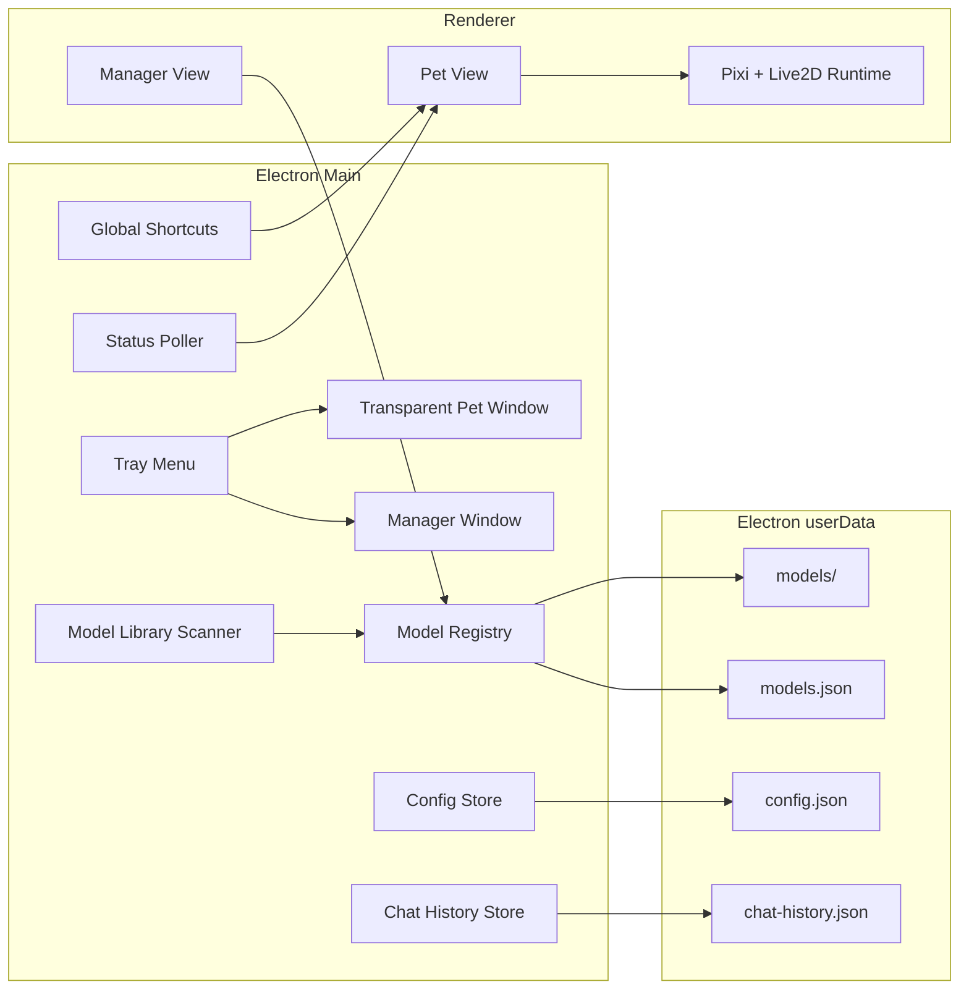

# Architecture



## Main Process

主进程负责所有本地文件和窗口操作：

- 创建透明宠物窗 / 管理窗 / 场景面板窗
- 托盘菜单
- IPC handler
- 导入模型目录、扫描本地模型库
- 保存配置
- 注册全局快捷键（`globalShortcut`）
- 聊天历史落盘
- 轮询本地 AI 状态服务

## Renderer

渲染器只通过 preload 暴露的 API 和主进程通信，不直接读写文件。
宠物窗与管理窗共用 `src/renderer/index.html`，通过 `?view=pet|manager` 区分。

## Model Registry

导入模型时：

1. 用户选择一个目录
2. 查找 `.model3.json` 或 `.model.json`
3. 复制整个目录到 `app.getPath("userData")/models/<id>`
4. 写入 `models.json`
5. 管理窗选择模型后写入 `config.json`

## Model Library（可选）

本地模型库扫描只读引用路径，不复制资源：

- 根目录来自 `DAIDAI_MODEL_LIBRARY` 环境变量或 `config.json` 的 `modelLibraryRoots`
- 目录约定：`<根>/1_FFhouse/<游戏>/<模型>`、`<根>/2_Tyrano/<游戏>/<模型>`
- 扫描结果合并进 `models.json`，并生成 `scenes.generated.json`
- 代码中不写死任何本机路径；未配置时扫描为空

## Scaling

`petWindowBase` 记录 100% 时的窗口尺寸，所有缩放入口（管理页滑块/数字框、快捷档位、托盘、`Ctrl+滚轮`、全局快捷键）都调用同一个 `applyPetScale`：

- 范围 25%~200%，1% 粒度，按底边中心缩放
- 受屏幕工作区限制时记录 `lastApply`，管理页提示实际显示比例
- 缩放期间用 `applyingPetScale` 标记避免 resize 事件写坏 `petWindowBase`

## Global Hotkeys

- 默认键位与动作元数据集中在 `config-store.js` 的 `DEFAULT_HOTKEYS` / `HOTKEY_ACTIONS`
- 主进程 `registerGlobalHotkeys()` 逐项注册并记录 `hotkeyStatus`（是否成功、失败原因、回退的旧键）
- 改键流程：先试注册新键 → 失败则恢复旧键，避免"改一次键全部失效"
- 渲染进程通过 `hotkeys:record` 进入录制模式（10 秒超时、Esc 取消）

## Chat Text & History

- 聊天主流程在宠物窗渲染进程；主进程通过 IPC 落盘
- `chat.textMode`：`always` / `when-tts-off` / `off`，控制文字气泡何时显示
- `chat-history.js` 按角色保存 `{ role, content, ts }`，写入前按 `chat.historyLimit` 裁剪
- 文件为 `user-data/chat-history.json`（同步读写，消息量小，无需数据库）

## Scene / Character System

- `config/characters.json`：角色 → 模型映射 + 每个角色一张提示词
- `config/scene-catalog.json`：模型 → 场景 → 动作目录（可手工校正）
- 聊天时根据当前模型解析角色卡与场景提示词，AI 可通过标签/工具调用切换动作

## AI Status Adapter

状态来源统一归一化后广播给宠物窗：

- `codex-jsonl`（`codex-session-monitor.js`）
- `claude-code-hook` / `http-bridge`（23334 `/status`、`/event`）

每个 adapter 输出统一状态：

```js
{
  source: "codex",
  kind: "thinking | running-tool | replying | complete | idle",
  text: "可展示的回复片段",
  tool: "shell_command",
  updatedAt: "ISO time"
}
```
